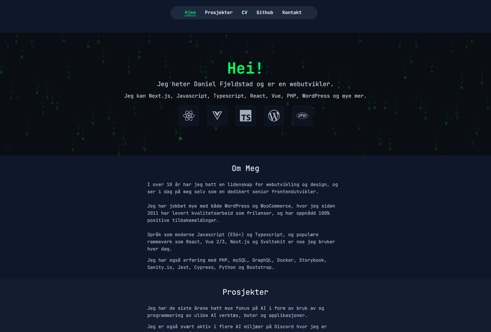

# Dfweb.no Portfolio Version 4

[](https://github.com/w3bdesign/dfweb-v4/actions/workflows/cypress.yml) [](https://github.com/w3bdesign/dfweb-v4/actions/workflows/lighthouse.yml) [](https://app.codacy.com/gh/w3bdesign/dfweb-v4/dashboard?utm_source=gh&utm_medium=referral&utm_content=&utm_campaign=Badge_grade) [](https://codecov.io/gh/w3bdesign/dfweb-v4)<br>[](https://github.com/w3bdesign/dfweb-v4/actions/workflows/pa11y.yml) [](https://github.com/w3bdesign/dfweb-v4/actions/workflows/react-doctor.yml) [](https://github.com/w3bdesign/dfweb-v4/actions/workflows/security.yml)

Fourth version of my personal portfolio website with Next.js, Motion,
Sanity.io and Typescript.

## Table of Contents

- [Live URL](#live-url)
- [Frontend (Next.js)](#frontend-nextjs)
- [Backend (Sanity headless CMS)](#backend-sanity-headless-cms)
- [Google Lighthouse](#google-lighthouse)
- [Features](#features)
  - [General](#general)
  - [Design](#design)
  - [Accessibility](#accessibility)
  - [Security](#security)
  - [Devops and Code quality](#devops-and-code-quality)
  - [Environment Variables](#environment-variables)
  - [Testing Standards](#testing-standards)

## Live URL

- <https://www.dfweb.no>

## Frontend (Next.js)



---

## Backend (Sanity headless CMS)


---

## Google Lighthouse


## Features

### General

- Clean, modern, responsive and Matrix-inspired design
- The application is 100% typescript (the types are generated from Sanity typegen)
- Matrix canvas rain effect on front page
- Custom 404 page with Matrix rain effect
- Next.js 16 with Typescript and App Router
  - Server Components implementation for improved performance
  - Streaming with Suspense boundaries
  - Automatic static optimization with revalidation
  - Server-side data fetching with proper error handling
- React 19
- Sanity headless CMS for all of the content, projects and navigation links
- Ladle for component documentation
- Animations with Motion
- React testing library for unit testing
- Cypress for E2E testing
- Playwright for cross-browser E2E testing
- Contact form sent directly from the browser with EmailJS (requires JavaScript)
- Polymorphic components
- Automatic sitemap generation in [`src/app/sitemap.ts`](src/app/sitemap.ts)
- Person and WebSite JSON-LD structured data shared across pages
- Lighthouse results shown above are measurements, not a guarantee for every run
- Automated Lighthouse CI testing integrated with GitHub Actions
- React Hook Form with Typescript and Zod for efficient form handling and validation
- Error handling with react-error-boundary for improved user experience and
  easier debugging
- AI-friendly repository documentation with automated updates (Repomix with
  Github action workflow)
- AI assistant guidance in a single root AGENTS.md for immediate productivity,
  covering project-specific patterns, gotchas, code quality principles, UI rules
  and supply chain security
- Sanity image URL generation with automatic resizing via `@sanity/image-url`.
- Cached, server-only project fetching with tag-based revalidation and preloading

### Design

- Responsive layouts with desktop and mobile styles
- React Icons for project icons
- Tailwind 4 for styling with a CSS custom-property design token system
  ([`tailwind.config.ts`](tailwind.config.ts:1)) — brand/matrix colors, semantic
  colors, surface palette, glow shadows, and custom animations all driven by
  CSS variables defined in [`globals.css`](src/app/globals.css:33)
- Animated reusable input fields
- Matrix-inspired animated cursor with dynamic trailing effect with fading
  Matrix characters
- Skeleton loaders with shimmer effects for smooth loading states and improved Lighthouse performance

### Accessibility

- WCAG accessibility tested
- Accessibility testing with Cypress Axe and Pa11y
- Automated Pa11y accessibility testing on every PR and push to main
  - Tests all main pages against WCAG2AA standards
  - Captures screenshots for visual reference
  - Detailed reports available as GitHub Actions artifacts
- Builds will fail if any a11y errors are found

### Devops and Code quality

- Continuous Integration with CircleCI
- CircleCI will warn before deploy if tests fail (setup for React testing library)
- Github action workflow for Cypress
- Code quality analysis with Codacy
- E2E testing with Cypress and Playwright integrated with Github actions
- Unit testing with Vitest and React Testing Library integrated with CircleCI
- Test coverage setup with Codecov
- Vitest coverage thresholds enforced for components, API routes and structured
  data (see [`DOCS/TEST-STRATEGY.md`](DOCS/TEST-STRATEGY.md))
- AI-powered commit message generation following Conventional Commits with
  gitmojis
- Automated React health checks with [React Doctor](https://github.com/millionco/react-doctor)
  - Scans for security, performance, correctness, and architecture issues
  - Outputs a 0–100 score with actionable diagnostics on every PR
  - Posts results as PR comments and GitHub Actions job summaries
  - Configurable score threshold (default: 80) to gate merges
  - Auto-detects package manager (pnpm, yarn, npm)
- Automated performance monitoring with Lighthouse CI
  - Performance, accessibility, best practices, and SEO checks on every PR
  - Configurable thresholds for quality metrics
  - Both desktop and performance-focused testing
- Automated repository documentation with Repomix
  - AI-friendly documentation generation on every push to main
  - Comprehensive repository context maintained in `DOCS/repository_context.txt`
  - Automated PR analysis with repository structure insights
  - Security-focused documentation with sensitive information filtering
  - Markdown formatting for improved readability
- Hard rules for code style, structure and architecture, enforced in CI by the
  Code Quality workflow (`.github/workflows/lint.yml`)
  - Prettier formatting check (`pnpm format:check`)
  - Stylelint for CSS (`pnpm lint:css`)
  - Architecture tests in `src/__tests__/architecture/`
    - Components end with `.component.tsx` and hooks start with `use`
    - Import boundaries between `app`, `components`, `hooks`, `lib`, `utils`
      and `types`
    - Production code never imports tests, mocks, stories or e2e code, and
      uses `@/` instead of `../` imports
  - Coverage floor in `vitest.config.mts` fails the Vitest run if coverage drops
  - Every rule and the check that enforces it is listed in `AGENTS.md`

### Security

- OWASP security scanning with Semgrep, Gitleaks and Trivy
  - Custom Semgrep SAST rules aligned to OWASP Top 10 2021 (`.semgrep/`)
  - React and Next.js specific security rules (XSS, SSRF, auth token storage)
  - Secret detection with Gitleaks on every PR and push
  - Dependency vulnerability scanning with Trivy (CRITICAL/HIGH severity)
  - Runs automatically on every PR and push to main
- Automated security vulnerability scanning with Snyk
  - Scans for vulnerabilities in open-source dependencies on every PR and push to main
  - Integrates with GitHub Security tab for vulnerability tracking
- Supply chain defenses with minimum release ages
  - Manual installs wait at least 48 hours, enforced via `.npmrc`
  - Renovate updates wait at least 7 days, configured in `renovate.json`
  - CI installs use `--frozen-lockfile` to preserve the committed dependency graph
  - Protects against compromised package releases (like Shai Hulud incidents)
- GitHub Actions supply chain hardening with SHA pinning
  - All workflow action references pinned to immutable commit SHAs (not mutable tags or branches)
  - Prevents tag-rewriting attacks (e.g. tj-actions/changed-files compromise)
  - Original version preserved as trailing comment for readability (`@<sha> # v6`)
  - Custom audit script at `scripts/pin-actions.py`
    - `python scripts/pin-actions.py audit` — scan and report mutable references
    - `python scripts/pin-actions.py verify` — CI gate (exit 1 if any unpinned)
    - `python scripts/pin-actions.py pin` — resolve tags/branches to SHAs and rewrite workflow files
    - `python scripts/pin-actions.py pin --dry-run` — preview changes without writing

### Environment Variables

Copy [`.env.example`](.env.example) to `.env.local` and configure the services
you use. Environment variables are read directly; there is no startup schema
validation.

| Variable | Purpose |
| --- | --- |
| `NEXT_PUBLIC_SANITY_PROJECT_ID` | Sanity project; defaults to `41s7iutf` |
| `NEXT_PUBLIC_SANITY_DATASET` | Sanity dataset; defaults to `production` |
| `NEXT_PUBLIC_SANITY_API_VERSION` | Sanity API version; defaults to `2026-05-01` |
| `NEXT_PUBLIC_EMAIL_API_KEY` | EmailJS public key, required to send the contact form |
| `NEXT_PUBLIC_EMAIL_TEMPLATE_KEY` | EmailJS template ID, required to send the contact form |
| `NEXT_PUBLIC_EMAIL_SERVICE_KEY` | EmailJS service ID, required to send the contact form |
| `REVALIDATE_SECRET` | Server-only secret for the Sanity revalidation webhook |

The EmailJS identifiers are intentionally public and bundled into the browser.
Never put private keys in `NEXT_PUBLIC_*` variables. Configure allowed origins
and any supported anti-abuse controls in the EmailJS dashboard. The form sends
through EmailJS, not a custom server endpoint, and requires JavaScript.

Generate a strong random value for `REVALIDATE_SECRET` and configure the same
value in the deployment environment and Sanity webhook. Without it, the
revalidation endpoint rejects requests; time-based content revalidation still
works.

### Testing Standards

- ISTQB-aligned comprehensive test strategy
  - Multi-level test approach (Unit, Component, E2E)
  - Risk-based testing methodology
  - Defined test metrics and reporting
  - Clear roles and responsibilities
  - Structured defect management process

- Enforced AAA (Arrange-Act-Assert) pattern in all test files
  - Each test must include the following comments:

    ```typescript
    // Arrange - Set up test data and conditions
    // Act - Perform the action being tested
    // Assert - Verify the results
    ```

  - This pattern ensures:
    - Clear test structure and readability
    - Consistent test organization across the codebase
    - Easy identification of test setup, execution, and verification
  - Simplified test maintenance and debugging
  - Automated validation through custom ESLint rules
  - Tests will fail if AAA pattern is not followed
